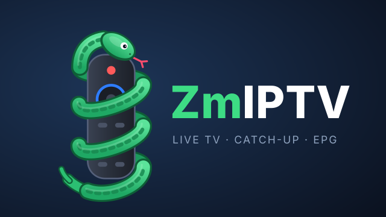
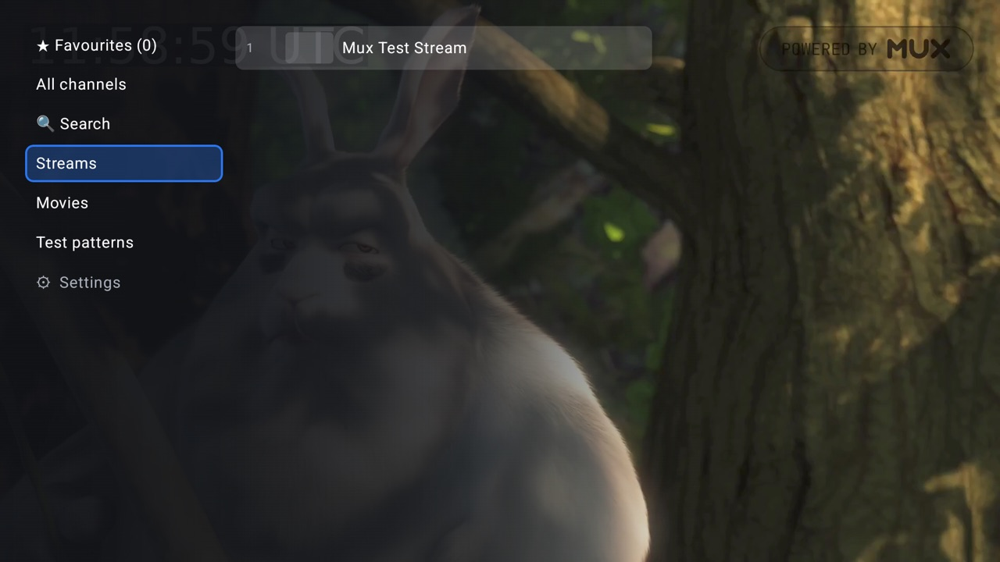
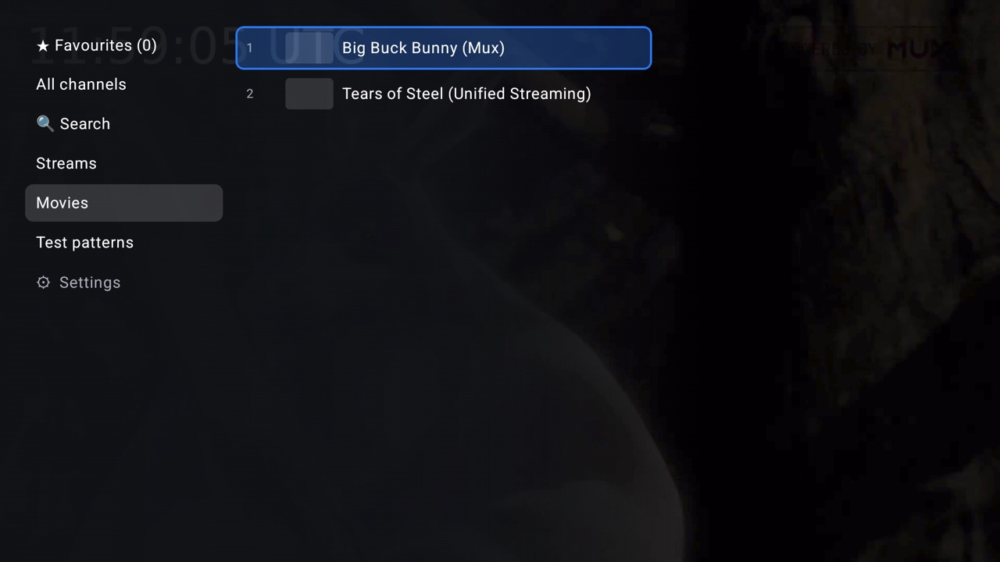
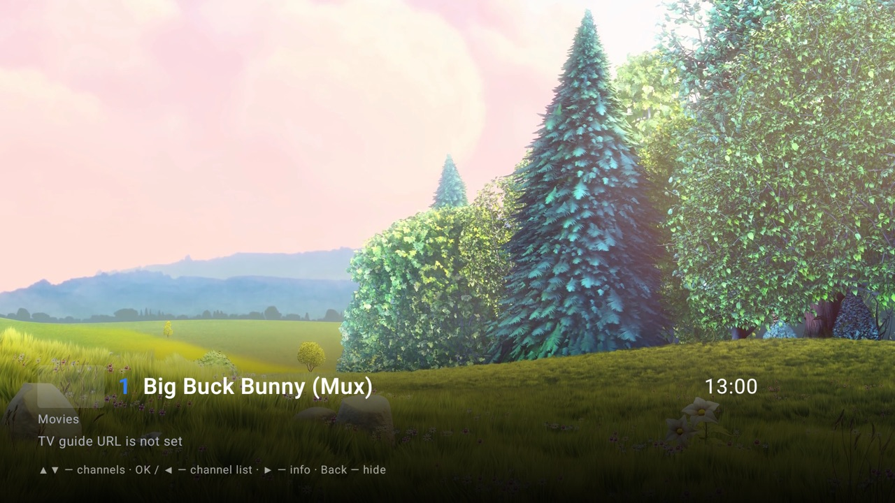
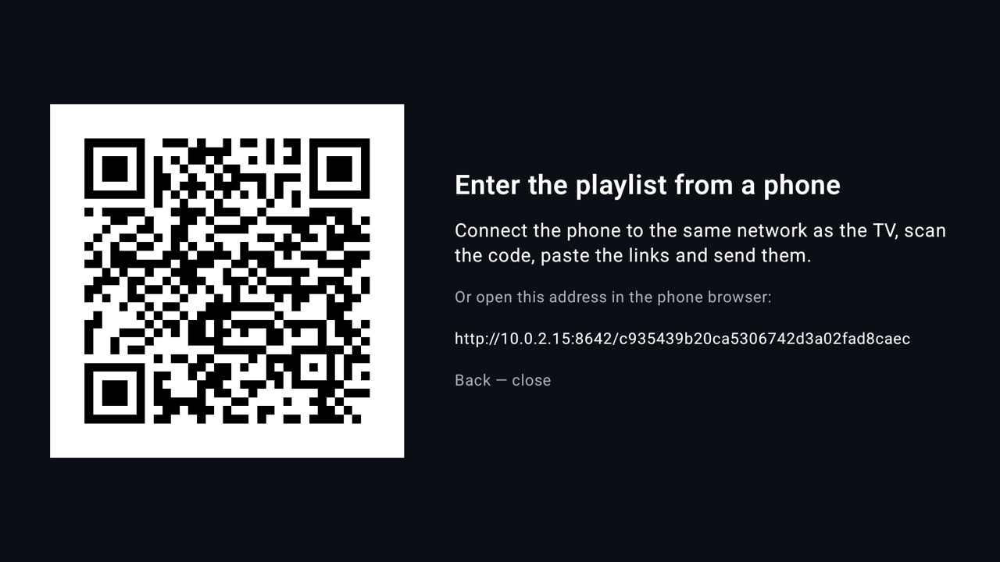

<p align="center"></p>

# ZmIPTV

An IPTV player for Android TV / Google TV, built for the remote control. You bring an M3U/M3U8 playlist; ZmIPTV adds the TV guide, channel logos, favourites, search and catch-up with pause and rewind.

Developed and tested on a Sony Bravia 5 (Google TV) with a ~2,900-channel playlist.

**[Русская версия](README.ru.md)**

> ZmIPTV is only a player. It contains no channels, playlists or streams. Use it with a playlist from a provider you subscribe to. The only exception is a small [demo list](docs/sample-playlist.m3u) of open test streams.

## Screenshots

<table>
<tr><td></td><td></td></tr>
<tr><td></td><td></td></tr>
</table>

Taken on the Android TV emulator with [`docs/sample-playlist.m3u`](docs/sample-playlist.m3u). Video: Big Buck Bunny and Tears of Steel, open films by the Blender Foundation (CC BY).

## Features

- **M3U / M3U8 playlists** with groups (`group-title` or `#EXTGRP`), numbering within each group.
- **TV guide (XMLTV, `.xml` / `.xml.gz`)** with channel logos. Guide entries are matched to channels by `tvg-id` or by name, so "Channel HD" and "Channel UHD" share one guide. The parsed guide is cached on the TV: the app starts in a few seconds even with a guide for ~2,900 channels.
- **Catch-up (archive):** watch past programmes from the guide, start the current one from the beginning, pause live TV and continue later, rewind ±30 s / ±5 min. Supports the `shift` scheme (`?utc=…&lutc=…`), `append` / `default` templates (`catchup-source`) and Flussonic.
- **Favourites** in your own order, **search** by channel name, previous channel.
- **Audio tracks:** choose the language on channels with several audio tracks; the choice is remembered per channel.
- **Resilient playback:** a frozen or stalled stream restarts automatically. If the stream keeps failing, the app switches to another variant of the same channel (e.g. FHD → HD) and tells you so.
- **Channels without a working archive** are detected in the background once a day and shown without the ⟲ mark.
- **Event channels** (one stream per live match, e.g. "… Event 12") are hidden while they have nothing on air.
- **Input from a phone:** scan a QR code on the TV and paste the playlist and guide URLs on the phone instead of typing them with the remote.
- **Five UI languages:** English, Русский, Polski, Беларуская, Українська.
- **Journal** for troubleshooting, without stream links or account keys.

## Requirements

- Android TV / Google TV, Android 8.0 or newer.
- An IPTV playlist URL (M3U / M3U8). An XMLTV guide URL is optional.

## Setup

On first launch the app opens **Settings**: enter the playlist URL there (and the guide URL, if your playlist header has no `url-tvg`). Settings can be reopened later from the bottom of the group list.

To avoid typing long links with the remote, choose **Enter from a phone (QR code)** in Settings and scan the code. The phone must be on the same network as the TV. Paste the links on the page that opens and send them. If the guide field is empty, the current guide URL is kept. The page exists only while the QR screen is open, its address contains a random key, and it accepts one submission.

No playlist yet? [`docs/sample-playlist.m3u`](docs/sample-playlist.m3u) has a few open test streams, so you can try the app without a provider. Enter its raw URL in Settings: `https://raw.githubusercontent.com/EugeneZmeuk/ZmIPTV/main/docs/sample-playlist.m3u`. Larger public lists are collected by the third-party [iptv-org](https://github.com/iptv-org/iptv) project; this repository does not maintain them.

For your own builds you can preset the URLs in `local.properties`. This file is git-ignored, so your account key never reaches the repository:

```
sdk.dir=/Users/<you>/Library/Android/sdk
iptv.playlistUrl=http://example.com/playlist.m3u8
# optional; when empty, the guide URL comes from the playlist header
iptv.epgUrl=http://example.com/epg.xml.gz
```

> An APK built with `iptv.playlistUrl` set contains your playlist URL. Do not share such an APK; build public releases without it.

## Build and install

Requires the Android SDK and JDK 17 (the JBR bundled with Android Studio works).

```
./gradlew assembleRelease      # app/build/outputs/apk/release/app-release.apk
./gradlew assembleDebug        # app/build/outputs/apk/debug/app-debug.apk
```

Use the release build on the TV: it is compiled ahead of time and noticeably faster than the debug build. It is signed with the debug key, so it installs without extra setup.

**Installing on a Google TV** (once):

1. *Settings → System → About* → press *Android TV OS build* 7 times to enable developer options.
2. *Settings → System → Developer options* → turn on *Wireless debugging*.
3. In *Wireless debugging* → *Pair device with pairing code*, then on the computer:

```
adb pair <TV-IP>:<pairing-port>          # enter the 6-digit code shown on the TV
adb connect <TV-IP>:<port>               # the port from the main "Wireless debugging" screen
adb install -r app/build/outputs/apk/release/app-release.apk
```

The connection port changes after the TV restarts; pairing is needed only once. Older Android TV devices without *Wireless debugging* use *Network debugging* and `adb connect <TV-IP>:5555`.

## Remote control

The same cheat sheet is in the app: *Settings → 🎮 Remote control buttons*.

**Live TV**

| Button | Action |
|---|---|
| ▲ / ▼ | previous / next channel in the current group (direction: setting "▲ button") |
| CH+ / CH− | next / previous channel |
| OK, ◀ | channel list |
| hold ◀ | rewind 30 s (channels with archive ⟲); hold longer to go faster |
| ▶, Info | channel panel: what is on now and next |
| hold OK, Audio | audio track (remembered per channel) |
| ⏯ | pause; continue from the same moment (channels with archive) |
| ⏪ / ⏩ | 5 min back / forward |
| 0–9 | channel by its number in the current group |
| Back | hide the panel; twice to exit |

**Archive and pause**

| Button | Action |
|---|---|
| OK, ⏯ | pause / continue |
| ◀ / ▶ | 30 s back / forward; hold to go faster |
| ⏪ / ⏩ | 5 min back / forward |
| hold OK | audio track |
| Back | back to live; then ◀ for the channel list |

**Channel list**

| Button | Action |
|---|---|
| ▲ / ▼ | groups and channels (★ Favourites, All channels, Search, provider groups, ⚙ Settings at the end) |
| ▶ on a group, OK | open the group |
| ◀ on a channel | back to groups |
| OK on a channel | watch |
| hold OK | add to / remove from ★ Favourites |
| ▶ on a channel | the channel's TV guide |
| Back | close the list |

**★ Favourites**

| Button | Action |
|---|---|
| hold OK on a channel | reorder: ⇅ appears |
| ▲ / ▼ | move the channel |
| OK or Back | done |
| hold OK again | remove from favourites |

**TV guide**

| Button | Action |
|---|---|
| ▲ / ▼ | programmes and days |
| OK on a past programme ⟲ | watch from the archive |
| OK on the current one | watch from the beginning (with archive) or live |
| ◀, Back | back to channels |

**Settings**

| Button | Action |
|---|---|
| OK on a field | edit the address; OK on the keyboard to finish |
| OK on "Enter from a phone" | show the QR code; Back closes it |
| OK on an item | change the value |
| Back | close settings |

## How it works

### Catch-up

The archive depth comes from the playlist (`catchup-days` or `tvg-rec`, in days). Some providers announce an archive the server does not actually keep. Once a day the app checks such channels in the background (4 requests at a time, about 2 minutes for ~1,000 channels) and shows the empty ones as channels without archive. A channel is re-checked after a failed rewind, and the mark expires after a day, so a repaired archive comes back on its own. Results are written to the journal (`archive check:` lines).

### Slow or unstable server

- The player buffers as far ahead as the server allows (up to 64 MB): up to the live edge on live TV (the provider window is typically 52–60 s), the whole provider window in the archive (≈60–100 s ahead).
- *Settings → Live buffer:* normal (≈30 s behind live), larger (≈40 s), maximum (≈45 s). A bigger buffer means a bigger delay.
- If the picture stands still for more than 10 s (loading, or a frozen frame on an empty buffer), the stream restarts on its own. Errors are retried up to 6 times with 3–30 s pauses.
- Some streams play video at double speed when audio frames are missing. The app detects heavy frame dropping and switches to another variant of the channel.
- If a stream freezes, fails or stalls 3 times within 2 minutes, the app switches to another variant of the same channel and says so. *Settings → Backup stream:* lower quality allowed (FHD → HD → no mark → orig → UHD, default); same quality or better only; or off (the stream only restarts, then asks you to choose another channel).
- Streams that never send an IDR frame (only I-frames with a recovery point, typical of interlaced sports channels) start normally: HLS accepts non-IDR keyframes (`StreamSourceFactory.kt`).

### Audio tracks

In HLS, ExoPlayer sees only one track per codec, so the app reads the list of audio tracks itself from the PMT table at the start of each segment. When a track other than the first is chosen, the audio stream IDs are swapped in each segment before it reaches the player (`AudioPids.kt`). Changing the track restarts the stream for 1–2 s.

### Logos and guide

Logos come from the guide (or `tvg-logo` in the playlist) and are cached on disk (Coil, `cache/image_cache`). The guide is downloaded at most every 12 hours; the parsed result is stored as a binary snapshot and the XML is re-parsed in the background only after a new download.

### Languages

*Settings → 🌐 Language:* English (default), Русский, Polski, Беларуская, Українська. The change applies at once. Channel, group and programme names stay as they are in the playlist and guide.

## Journal

The app writes a journal on the TV: `/sdcard/Android/data/com.zmeuk.zmiptv/files/logs/zmiptv.log` (up to 3 files of 1 MB; path and size are shown at the bottom of Settings). **Stream links are never written to the journal, because they contain the account key.**

It records start-up (version, TV model, Android, memory, settings), playlist and guide loading, every channel and archive switch, start-up time, rebuffering, freezes, restarts, backup-stream switches, player and network errors, crashes with stack traces and low-memory events. Every 30 s it adds a summary: buffer, delay behind live, resolution, dropped frames and network (how long a 10-s segment took to download as % of real time, Mbit/s, playlist load time, errors). Above 100 % the server is too slow and the buffer is melting.

To copy the journal to a computer (wireless debugging on, paired once):

```
scripts/pull-logs.sh <TV-IP>:<port>
```

The files land in `logs/<date-time>/`: `zmiptv.log` (app journal), `logcat.txt` (system log since the last reboot), `crash.txt`.

## Privacy

- The playlist URL lives only in the app's settings on the TV (and in your `local.properties` if you build with it).
- The app talks only to your provider, the guide server and the logo servers named in the guide. There is no analytics or telemetry.
- The journal stays on the TV unless you pull it yourself, and it contains host names only, never full stream URLs.

## Tech stack

Kotlin, Jetpack Compose, Media3 / ExoPlayer (HLS), Coil, ZXing. Minimum Android 8.0 (API 26).

## Privacy

ZmIPTV does not collect personal data and does not send it to third parties. It has no accounts, analytics, advertising or crash reporting, and no servers of its own.

- **Settings and links** stay on the device. They are excluded from Android backups and device transfers.
- **Network requests** go only to the addresses from your settings and playlist: the playlist, the TV guide, streams and channel logos. Those services see what any web service sees, such as your IP address and which stream you open.
- **The journal** stays on the device. It contains channel names, provider host names and errors, but no stream links or account keys. It leaves the device only if you copy it yourself.
- **Input from a phone** works inside your local network, over plain HTTP. Use it only on a network you trust.

## License

- **Code:** [PolyForm Noncommercial License 1.0.0](LICENSE). You may take the code, change it and use it for any noncommercial purpose, including sharing it with others. Keep the `Required Notice` line from the license when you share it. Commercial use is not allowed.
- **UI and UX design:** all rights reserved. This covers the look of the screens, the logo, icons, banner, splash screen and the ZmIPTV name. You may build and run the app with them for your own noncommercial use. Reusing them in another project, or publishing an app that uses them to an app store, requires written permission. See [LICENSE](LICENSE) for details.

Third-party libraries and the Gradle wrapper keep their own licenses.
