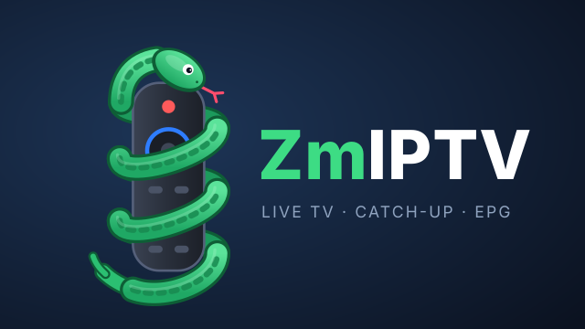
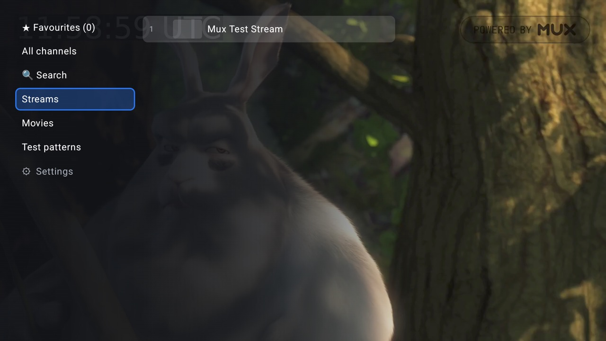
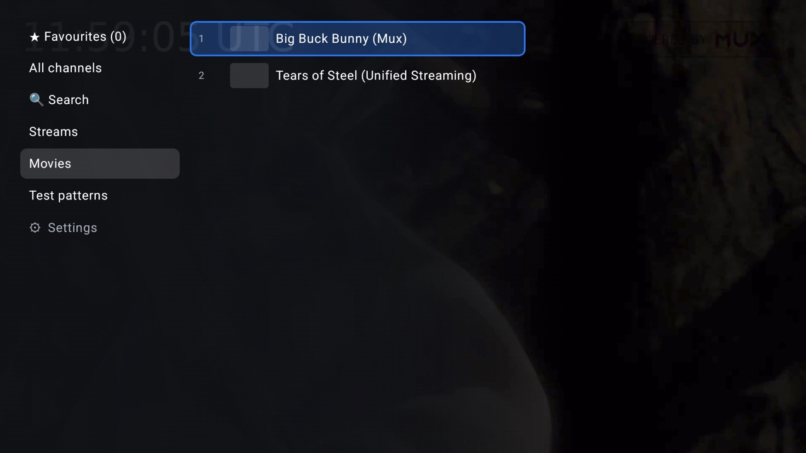
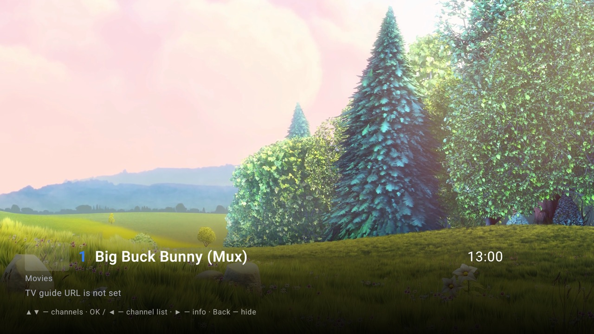
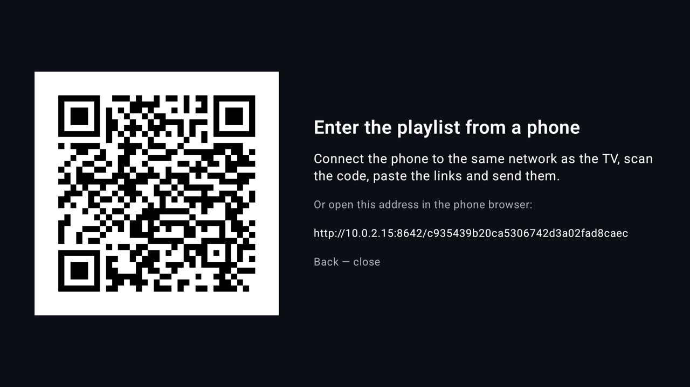

<p align="center"></p>

# ZmIPTV

IPTV-плеер для Android TV / Google TV, сделанный под пульт. Вы даёте ему M3U/M3U8-плейлист, а ZmIPTV добавляет телепрограмму, логотипы каналов, избранное, поиск и архив с паузой и перемоткой.

Разработан и проверен на Sony Bravia 5 (Google TV) с плейлистом примерно на 2900 каналов.

**[English version](README.md)**

> ZmIPTV — только плеер. В нём нет каналов, плейлистов и потоков. Используйте его с плейлистом провайдера, у которого у вас есть подписка. Единственное исключение — небольшой [демо-список](docs/sample-playlist.m3u) открытых тестовых потоков.

## Скриншоты

<table>
<tr><td></td><td></td></tr>
<tr><td></td><td></td></tr>
</table>

Сняты на эмуляторе Android TV с [`docs/sample-playlist.m3u`](docs/sample-playlist.m3u). Видео: Big Buck Bunny и Tears of Steel, открытые фильмы Blender Foundation (CC BY).

## Возможности

- **Плейлисты M3U / M3U8** с группами (`group-title` или `#EXTGRP`), нумерация внутри каждой группы.
- **Телепрограмма (XMLTV, `.xml` / `.xml.gz`)** с логотипами каналов. Передачи сопоставляются с каналами по `tvg-id` или по названию, поэтому «Канал HD» и «Канал UHD» получают одну программу. Разобранная программа хранится на телевизоре: даже с программой на ~2900 каналов приложение запускается за несколько секунд.
- **Архив:** прошедшие передачи из телепрограммы, текущая — с начала, пауза эфира с продолжением, перемотка ±30 с / ±5 мин. Поддерживаются схема `shift` (`?utc=…&lutc=…`), шаблоны `append` / `default` (`catchup-source`) и Flussonic.
- **Избранное** в своём порядке, **поиск** по названию, предыдущий канал.
- **Звуковые дорожки:** выбор языка на каналах с несколькими дорожками, выбор запоминается для канала.
- **Устойчивое воспроизведение:** зависший или застывший поток перезапускается сам. Если поток продолжает сбоить, приложение включает другой вариант того же канала (например, FHD → HD) и пишет об этом.
- **Каналы без рабочего архива** раз в сутки определяются в фоне и показываются без значка ⟲.
- **Каналы-события** (отдельный поток на каждый матч, например «… Event 12») скрываются, пока в них ничего не идёт.
- **Ввод с телефона:** отсканируйте QR-код на телевизоре и вставьте ссылки на плейлист и телепрограмму на телефоне, не набирая их пультом.
- **Пять языков интерфейса:** English, Русский, Polski, Беларуская, Українська.
- **Журнал** для разбора сбоев, без ссылок на потоки и ключей.

## Что нужно

- Android TV / Google TV на Android 8.0 или новее.
- Ссылка на IPTV-плейлист (M3U / M3U8). Ссылка на телепрограмму XMLTV — по желанию.

## Настройка

При первом запуске приложение открывает **Настройки**: введите там ссылку на плейлист (и на телепрограмму, если в заголовке плейлиста нет `url-tvg`). Потом настройки открываются из самого низа списка групп.

Чтобы не набирать длинные ссылки пультом, выберите в Настройках **Ввести с телефона (QR-код)** и отсканируйте код. Телефон должен быть в той же сети, что и телевизор. Вставьте ссылки на открывшейся странице и отправьте. Если поле телепрограммы пустое, текущая ссылка сохранится. Страница работает, только пока открыт экран с QR-кодом, в её адресе есть случайный ключ, и она принимает одну отправку.

Плейлиста пока нет? В [`docs/sample-playlist.m3u`](docs/sample-playlist.m3u) есть несколько открытых тестовых потоков: с ними можно проверить приложение без провайдера. Введите в Настройках ссылку на файл: `https://raw.githubusercontent.com/EugeneZmeuk/ZmIPTV/main/docs/sample-playlist.m3u`. Большие публичные списки собирает сторонний проект [iptv-org](https://github.com/iptv-org/iptv); этот репозиторий их не поддерживает.

Для своей сборки ссылки можно заранее прописать в `local.properties`. Этот файл исключён из git, так что ключ доступа не попадёт в репозиторий:

```
sdk.dir=/Users/<you>/Library/Android/sdk
iptv.playlistUrl=http://example.com/playlist.m3u8
# необязательно; если пусто, ссылка на телепрограмму берётся из заголовка плейлиста
iptv.epgUrl=http://example.com/epg.xml.gz
```

> APK, собранный с `iptv.playlistUrl`, содержит вашу ссылку на плейлист. Не раздавайте такой APK; публичные сборки делайте без неё.

## Сборка и установка

Нужны Android SDK и JDK 17 (подойдёт JBR из Android Studio).

```
./gradlew assembleRelease      # app/build/outputs/apk/release/app-release.apk
./gradlew assembleDebug        # app/build/outputs/apk/debug/app-debug.apk
```

На телевизор ставьте release-сборку: она заранее скомпилирована и заметно быстрее debug. Она подписана debug-ключом, поэтому ставится без дополнительной настройки.

**Установка на Google TV** (один раз):

1. *Настройки → Система → Об устройстве* → 7 раз нажать на *Сборка ОС Android TV*, чтобы включить режим разработчика.
2. *Настройки → Система → Для разработчиков* → включить *Беспроводная отладка*.
3. В *Беспроводной отладке* → *Подключить устройство с помощью кода*, затем на компьютере:

```
adb pair <IP-телевизора>:<порт-сопряжения>   # ввести шестизначный код с экрана телевизора
adb connect <IP-телевизора>:<порт>            # порт с главного экрана «Беспроводной отладки»
adb install -r app/build/outputs/apk/release/app-release.apk
```

Порт подключения меняется после перезагрузки телевизора, сопряжение нужно только один раз. На старых Android TV без *Беспроводной отладки* включается *Отладка по сети* и используется `adb connect <IP-телевизора>:5555`.

## Пульт

То же самое есть в приложении: «Настройки» → «🎮 Кнопки пульта».

**Просмотр эфира**

| Кнопка | Действие |
|---|---|
| ▲ / ▼ | предыдущий / следующий канал текущей группы (направление — настройка «Кнопка ▲») |
| CH+ / CH− | следующий / предыдущий канал |
| OK, ◀ | список каналов |
| удерживать ◀ | перемотка на 30 с назад (каналы с архивом ⟲); держать дольше — быстрее |
| ▶, Info | панель канала: что идёт сейчас и дальше |
| удерживать OK, Audio | звуковая дорожка канала (запоминается для канала) |
| ⏯ | пауза; продолжение с того же места (каналы с архивом) |
| ⏪ / ⏩ | перемотка на 5 мин назад / вперёд |
| 0–9 | канал по номеру в текущей группе |
| Назад | скрыть панель; дважды — выход |

**Архив и пауза**

| Кнопка | Действие |
|---|---|
| OK, ⏯ | пауза / продолжить |
| ◀ / ▶ | 30 с назад / вперёд; удерживать — быстрее |
| ⏪ / ⏩ | 5 мин назад / вперёд |
| удерживать OK | звуковая дорожка |
| Назад | в прямой эфир; затем ◀ — список каналов |

**Список каналов**

| Кнопка | Действие |
|---|---|
| ▲ / ▼ | группы и каналы (★ Избранное, Все каналы, Поиск, группы провайдера, в конце ⚙ Настройки) |
| ▶ на группе, OK | открыть группу |
| ◀ на канале | назад к группам |
| OK на канале | смотреть |
| удерживать OK | добавить в ★ Избранное / убрать |
| ▶ на канале | телепрограмма канала |
| Назад | закрыть список |

**★ Избранное**

| Кнопка | Действие |
|---|---|
| удерживать OK на канале | изменить порядок: появится ⇅ |
| ▲ / ▼ | передвинуть канал |
| OK или Назад | готово |
| ещё раз удерживать OK | убрать из избранного |

**Телепрограмма**

| Кнопка | Действие |
|---|---|
| ▲ / ▼ | передачи и дни |
| OK на прошедшей передаче ⟲ | смотреть из архива |
| OK на текущей | смотреть с начала (если есть архив) или эфир |
| ◀, Назад | назад к каналам |

**Настройки**

| Кнопка | Действие |
|---|---|
| OK на поле | изменить адрес; OK на клавиатуре — готово |
| OK на «Ввести с телефона» | показать QR-код; Назад закрывает его |
| OK на пункте | сменить значение |
| Назад | закрыть настройки |

## Как это устроено

### Архив

Глубина архива берётся из плейлиста (`catchup-days` или `tvg-rec`, в днях). Некоторые провайдеры заявляют архив, которого на сервере на самом деле нет. Раз в сутки приложение проверяет такие каналы в фоне (по 4 запроса параллельно, около 2 минут на ~1000 каналов) и показывает пустые как каналы без архива. После неудачной перемотки канал перепроверяется, а отметка живёт сутки, так что починенный архив вернётся сам. Итог проверки пишется в журнал (строки `archive check:`).

### Медленный или нестабильный сервер

- Плеер качает наперёд столько, сколько отдаёт сервер (до 64 МБ): в эфире — до живого края (окно провайдера обычно 52–60 с), в архиве — всё окно провайдера (≈60–100 с вперёд).
- «Настройки» → «Буфер эфира»: обычный (≈30 с от эфира), увеличенный (≈40 с), максимальный (≈45 с). Больше запас — больше отставание от эфира.
- Если картинка стоит дольше 10 с (загрузка или застывший кадр при пустом буфере), поток перезапускается сам. Ошибки повторяются до 6 раз с паузой 3–30 с.
- Некоторые потоки при потере звуковых кадров играют видео вдвое быстрее. Приложение замечает массовую потерю кадров и включает другой вариант канала.
- Если поток завис, недоступен или тормозит 3 раза за 2 минуты, приложение включает другой вариант того же канала и пишет об этом. «Настройки» → «Запасной поток»: можно хуже качеством (FHD → HD → без пометки → orig → UHD, по умолчанию); только того же качества или лучше; выключен (поток только перезапускается, а потом приложение просит выбрать другой канал).
- Потоки без IDR-кадров (только I-кадры с точкой восстановления, так бывает у чересстрочных спортивных каналов) запускаются нормально: для HLS разрешены ключевые кадры не-IDR (`StreamSourceFactory.kt`).

### Звуковые дорожки

ExoPlayer в HLS видит только одну дорожку каждого кодека, поэтому список дорожек приложение читает само из таблицы PMT в начале каждого фрагмента. Если выбрана не первая дорожка, номера звуковых потоков во фрагменте меняются местами до передачи в плеер (`AudioPids.kt`). Смена дорожки перезапускает поток на 1–2 с.

### Логотипы и телепрограмма

Логотипы берутся из телепрограммы (или `tvg-logo` плейлиста) и кешируются на диске (Coil, `cache/image_cache`). Телепрограмма скачивается не чаще раза в 12 часов; разобранный результат хранится в двоичном виде, а XML разбирается заново в фоне только после новой загрузки.

### Языки

«Настройки» → «🌐 Language»: English (по умолчанию), Русский, Polski, Беларуская, Українська. Переключается сразу. Названия каналов, групп и передач остаются как в плейлисте и телепрограмме.

## Журнал

Приложение пишет журнал на телевизоре: `/sdcard/Android/data/com.zmeuk.zmiptv/files/logs/zmiptv.log` (до 3 файлов по 1 МБ; путь и размер видны внизу «Настроек»). **Ссылки на потоки в журнал не пишутся: в них ключ доступа.**

Что там есть: запуск (версия, модель ТВ, Android, память, настройки), загрузка плейлиста и телепрограммы, каждое включение канала и архива, время старта, паузы на дозагрузку, зависания, перезапуски, переходы на запасной поток, ошибки плеера и сети, падения со стеком, нехватка памяти. Раз в 30 с — сводка: буфер, отставание от эфира, разрешение, потерянные кадры и сеть (сколько качался 10-секундный фрагмент в % от реального времени, Мбит/с, время загрузки плейлиста, ошибки). Больше 100% — сервер не успевает, буфер тает.

Забрать журнал на компьютер (беспроводная отладка включена, сопряжение сделано):

```
scripts/pull-logs.sh <IP-телевизора>:<порт>
```

Файлы окажутся в `logs/<дата-время>/`: `zmiptv.log` (журнал приложения), `logcat.txt` (системный лог с последней перезагрузки), `crash.txt`.

## Приватность

- Ссылка на плейлист хранится только в настройках приложения на телевизоре (и в вашем `local.properties`, если собираете с ней).
- Приложение обращается только к вашему провайдеру, серверу телепрограммы и серверам логотипов из неё. Никакой аналитики и телеметрии.
- Журнал остаётся на телевизоре, пока вы сами его не заберёте, и содержит только имена серверов, без полных ссылок на потоки.

## Технологии

Kotlin, Jetpack Compose, Media3 / ExoPlayer (HLS), Coil, ZXing. Минимальная версия Android 8.0 (API 26).

## Конфиденциальность

ZmIPTV не собирает личные данные и не передаёт их третьим сторонам. В приложении нет аккаунтов, аналитики, рекламы и отправки отчётов о сбоях, и у него нет своих серверов.

- **Настройки и ссылки** хранятся на устройстве. Они исключены из резервных копий Android и переноса на другое устройство.
- **Сетевые запросы** идут только на адреса из ваших настроек и плейлиста: плейлист, телепрограмма, потоки и логотипы каналов. Эти сервисы видят то же, что любой веб-сервис, например ваш IP-адрес и какой поток открыт.
- **Журнал** хранится на устройстве. В нём есть названия каналов, имена серверов провайдера и ошибки, но нет ссылок на потоки и ключей доступа. С устройства он уходит, только если вы сами его скопируете.
- **Ввод с телефона** работает внутри вашей локальной сети по обычному HTTP. Используйте его только в сети, которой доверяете.

## Лицензия

- **Код:** [PolyForm Noncommercial 1.0.0](LICENSE). Код можно брать, изменять и использовать для любых некоммерческих целей, в том числе делиться им с другими. При передаче сохраняйте строку `Required Notice` из лицензии. Коммерческое использование запрещено.
- **Дизайн интерфейса (UI/UX):** все права защищены. Это внешний вид экранов, логотип, значки, баннер, заставка и название ZmIPTV. Собирать и запускать приложение с ними можно для личного некоммерческого использования. Для использования в другом проекте или публикации приложения с ними в магазине приложений нужно письменное разрешение. Подробности в [LICENSE](LICENSE).

Сторонние библиотеки и Gradle Wrapper остаются под своими лицензиями, см. [NOTICE](NOTICE).
